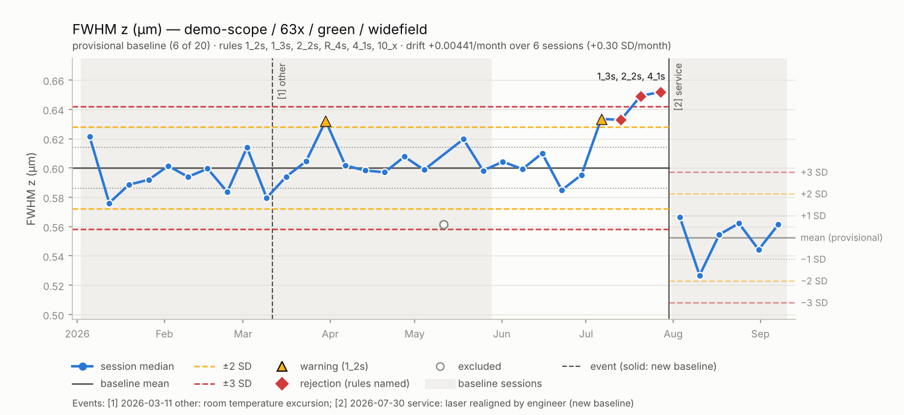

# PSFWidget

PSFWidget is a microscope quality-control tool for point spread functions (PSFs). It will:

- analyze empirical PSFs from 3D bead images in `.nd2`, `.lif`, `.czi`, and `.tif` files;
- compare them with theoretical PSFs;
- track performance over time on Levey-Jennings charts;
- produce scheduled, distributable reports.

> **Status:** Pre-alpha. File import (M1), bead measurement (M2), and
> tracking over time (M3) work: PSFWidget reads bead stacks in all four
> formats, measures each bead, compares the results with a theoretical PSF,
> and tracks them on Levey-Jennings charts with Westgard rules. Reports and
> scheduled runs (M4) are next.

## Planning documents

- [Project Plan, Requirements, Tasks & Milestones](docs/PLAN.md)
- [Verification & Validation Plan](docs/VV_PLAN.md)
- [Requirements traceability matrix](docs/traceability.csv)
- [Dependency licence audit](docs/LICENSE_AUDIT.md)

## What works today

Inspect a file and the metadata PSFWidget would use for it:

```bash
psfwidget info beads.nd2 --profile examples/profiles/csu-livesr.toml
```

The output lists the image series, each metadata value with its origin
(file, profile, or user), and whether the stack is ready for analysis. Use
`--set numerical_aperture=1.4` or `--set channel.0.emission_nm=515` to
override a value, and `--json` for machine-readable output.

An instrument profile supplies what files do not record, such as the bead
size and the bead dye's emission peaks. See
[examples/profiles](examples/profiles/README.md).

Measure the beads and write the results:

```bash
psfwidget analyze beads.lif --series 2 --profile examples/profiles/sp8.toml --out results/
```

For each channel this prints the median FWHM in x, y, and z with the
theoretical value and their ratio, plus ellipticity, signal-to-background,
signal-to-noise, why beads were rejected, and any spec-limit failures. It
writes four files to `results/`:

| File | Contents |
|---|---|
| `<name>_beads.csv` | One row per bead: position, FWHM (raw and bead-size corrected), plane fits, intensity, SBR, SNR, fit quality, status, and rejection reasons |
| `<name>_summary.csv` | n, mean, SD, median, and quartiles of each metric over accepted beads |
| `<name>_channels.csv` | Per channel: bead counts, theoretical PSF and model, spec status, notes |
| `<name>_run.json` | All of the above plus the settings, metadata, and file provenance |

Analysis settings can be changed with `--setting`, e.g. `--setting min_snr=5`;
see `psfwidget.settings.AnalysisSettings` for the full list.

From Python:

```python
from psfwidget.analysis import analyze_stack
from psfwidget.io import read_stack
from psfwidget.profiles import load_profile

profile = load_profile("sp8.toml")
stack = read_stack("beads.lif", series=2, profile=profile)
result = analyze_stack(stack, spec_limits=profile.spec)
for channel in result.channels:
    print(channel.name, channel.summary["fwhm_z_um"].median)
```

How accurate the FWHM measurement is on synthetic beads is documented in
[docs/validation/fitting_accuracy.md](docs/validation/fitting_accuracy.md).

### Tracking performance over time

Add `--db` to record each analysis in a results database, filed by
instrument, objective, channel, and modality (the instrument comes from the
profile):

```bash
psfwidget analyze beads.nd2 --profile examples/profiles/axr-nsparc.toml --db qc.sqlite --out results/
```

After recording, it prints how the session compares with each channel's
control limits. Control limits come from the first 20 sessions by default
(provisional until then), and each session is checked against the Westgard
rules 1₂ₛ (warning), 1₃ₛ, 2₂ₛ, R₄ₛ, 4₁ₛ, and 10ₓ (rejection).

```bash
psfwidget track status --db qc.sqlite                       # latest session vs limits
psfwidget track chart  --db qc.sqlite --out charts/         # Levey-Jennings charts
psfwidget track event  --db qc.sqlite --instrument axr --kind service \
    --description "laser realigned" --rebaseline            # new limits from here on
psfwidget track exclude --db qc.sqlite 17 --reason "dirty slide"
psfwidget track export --db qc.sqlite --out qc.csv
psfwidget track audit  --db qc.sqlite                       # who changed what, when
```

Nothing in the database is ever edited or deleted. Exclusions, re-inclusions,
and events are added as new rows and recorded in the audit log.



*Simulated weekly sessions from `python tools/demo_tracking.py OUT_DIR`: a
stable baseline, an excluded dirty-slide session, a drift caught by the
Westgard rules, and a service visit that starts new (provisional) limits.*

Charts need matplotlib: `pip install "psfwidget[report]"`.

### Reports

Add `--report` to write a session report, and `--xlsx` for an Excel workbook:

```bash
psfwidget analyze beads.lif --series 2 --profile examples/profiles/sp8.toml \
    --db qc.sqlite --out results/ --report html,pdf --xlsx
```

A session report has an overall PASS, WARNING, FAIL, or NOT EVALUATED status
with the reasons for it, the acquisition settings, and for each channel: the
metric summary against theory, the Westgard and spec-limit checks, a bead
overview, XY/XZ/YZ views and profile fits of a representative bead, and a
table of every bead. It ends with the provenance (software version, settings,
file name and SHA-256 hash, operator). The HTML file is self-contained, so it
can be emailed or put on a shared drive as it is.

A trend report covers one instrument over a period: the latest status of each
configuration, every rule violation, events, and Levey-Jennings charts.

```bash
psfwidget report trend --db qc.sqlite --instrument sp8 --days 90 --out reports/
```

Reports need `pip install "psfwidget[report]"`.

### Unattended runs

A configuration file lists the folders to watch, the instrument profile for
each, where reports go, and when jobs run. See
[examples/automation/qc.toml](examples/automation/qc.toml), and check a file
with:

```bash
psfwidget check-config qc.toml
```

`psfwidget run --config qc.toml` runs whatever is due and exits:

- **ingest** (e.g. `every 15 minutes`): new files in the watched folders are
  analysed, recorded in the database, and given a session report and
  exports under the output folder. A file is left alone until it has not
  changed for `settle_seconds`, a file already in the database is skipped,
  and a file that cannot be read is logged without stopping the others.
- **trend_report** (e.g. `weekly monday 07:30`): a trend report per
  instrument over the last `trend_days`.

Schedules are written as `every N minutes|hours|days`, `daily HH:MM`,
`weekly <weekday> HH:MM`, `monthly <day 1-28> HH:MM`, or `off`, in the
computer's local time. Add `--job trend_report` (or `--job all`) to run a job
now even if it is not due.

After every run, `STATUS.json` in the output folder holds the latest status
of every configuration. `ALERT.txt` appears there while a latest session
FAILs (spec limits or a Westgard rejection) or the last run had errors, and
is removed once both clear, so a shared-drive watcher or a monitoring script
only has to check for that file. Logs and a JSON summary of every run are in
`<output>/_psfwidget/`.

To run on a schedule, either keep `psfwidget watch --config qc.toml` running
(it checks every minute), or have the operating system start
`psfwidget run` every few minutes:

- **Linux or macOS (cron):** `crontab -e`, then add

  ```
  */5 * * * * /path/to/venv/bin/psfwidget run --config /path/to/qc.toml >> /path/to/cron.log 2>&1
  ```

- **Windows (Task Scheduler):** in an administrator command prompt,

  ```
  schtasks /Create /TN "PSFWidget QC" /SC MINUTE /MO 5 /TR "\"C:\path\to\venv\Scripts\psfwidget.exe\" run --config \"C:\path\to\qc.toml\""
  ```

  then, in Task Scheduler, set the task to run whether or not the user is
  logged on, under an account that can read the watched folders.

Two runs never overlap: a run that starts while another is in progress exits
with status 6.

### Review, approval, and self-test (GLP)

Every record in the results database carries the user, computer, and UTC
time. To sign a report after reviewing it:

```bash
psfwidget approve reports/sp8/2026/2026-11-14_beads_s0.pdf --db qc.sqlite --session 12
```

This records the approval (or, with `--reject`, a rejection) with its meaning
and an optional `--comment`, tied to the report's SHA-256, and writes a
`.signature.json` file next to the report. `psfwidget verify REPORT --db
qc.sqlite` shows who signed it and whether it has changed since.

`psfwidget selftest --out qualification/` checks the installation on
synthetic data with known answers and writes an IQ/OQ record to sign.
`psfwidget track audit --db qc.sqlite --since 2026-10-01 --csv audit.csv`
exports the audit trail for periodic review.

### napari GUI

```bash
pip install "psfwidget[napari]"
napari
```

Then open *Plugins → PSFWidget*:

- **PSF analysis**: choose a file, series, and (optionally) an instrument
  profile, then *Open*. Missing required metadata is highlighted in red;
  type a value in the table to set it. *Analyse* runs in the background.
  Accepted beads are shown as green circles and rejected beads as red ones;
  tick *3D view* to inspect them in 3D. To exclude or include beads by hand,
  select them in the *bead review* points layer, give a reason and your name,
  and press *Exclude selected beads* or *Include selected beads*: the metrics
  and spec checks update, and the decision is kept with the bead. *Record in
  database* and *Write report* save the reviewed result.
- **PSF tracking (Levey-Jennings)**: choose a results database to see each
  configuration's latest state and its charts. Hover over a point for the
  session; click it to select it, then exclude or include it with a reason.
  Events (service, alignment, …) can be added, optionally starting new
  control limits.
- **Instrument profile editor**: create or edit a profile, including spec
  limits and tracked metrics. *Check* validates it; only a valid profile is
  saved.

*File → Open Sample → PSFWidget* opens a synthetic bead field to try it on.

## Development

You need Python 3.12 or newer.

```bash
python -m pip install -e ".[dev]"
pre-commit install
python -m pytest
```

See [CONTRIBUTING.md](CONTRIBUTING.md) for checks, coding standards, how
tests are linked to requirements, and the release process.

## License

MIT. See [LICENSE](LICENSE).
